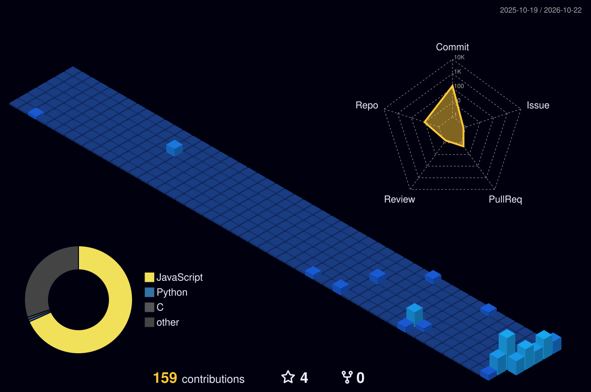

# Hi there, I'm Ankita 👋

---

### 🚀 About Me
- 🔭 **Currently Working On:** Full-stack web applications, frontend architectures, and interactive web tools.
- 🌱 **Learning & Exploring:** Data Structures & Algorithms, Machine Learning, and Agentic AI workflows.
- 💡 **Interests:** Software engineering, UI/UX design, and practical AI application development.

---

### 🛠 Tech Stack
**Languages:**
`C` `C++` `Python` `JavaScript` `HTML5` `CSS3`

**Frameworks & Libraries:**
`React` `FastAPI` `Node.js` `Streamlit` `Tailwind CSS`

**Tools & Developer Environment:**
`Git` `GitHub` `WSL` `Vite` `VS Code`

---

### 🤝 Collaborative Projects
* 🌟 **[UIG-website](https://github.com/pavitrabehera7-ui/UIG-website):** Contributed to the development and UI design of the User Interface Group web application.

---

### 📌 Personal & Featured Repositories
* 🐱 **[cat-website](https://github.com/ankita25-06/cat-website):** Feline health triage and interactive web app built with JavaScript.
* 🌌 **[Zenith](https://github.com/ankita25-06/Zenith):** Modern web application built with JavaScript.
* 🎮 **[PTCG-game](https://github.com/ankita25-06/PTCG-game):** Interactive web application.
* 🚢 **[titanic_survival_app](https://github.com/ankita25-06/titanic_survival_app):** Machine learning application for survival analysis built in Python.

---

### 📊 STATS & CONTRIBUTIONS

 

---

📫 **Reach Out:** Feel free to connect on [LinkedIn](https://www.linkedin.com/in/ankita-mallik-22164738a) for software development collaborations or open-source projects!
